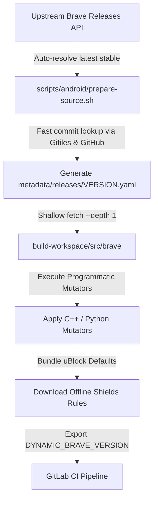
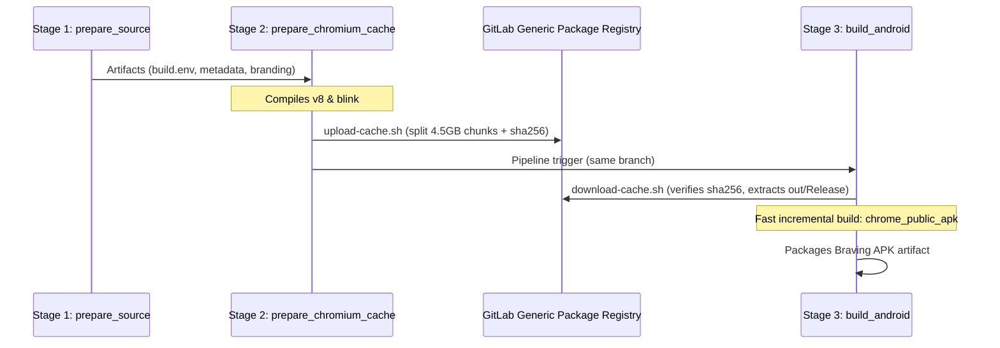

# Braving Browser: The Complete Engineering & Agent Guide

Welcome to the **Braving Browser** skill. This guide serves as the definitive reference for autonomous agents and engineers working on the Braving codebase.

---

## 1. Project Vision & Architectural Foundation

### What is Braving?
**Braving** is an independent downstream distribution of the Brave Browser. It is customized to be:
1. **Completely De-Branded**: Stripped of all Brave Lion branding, proprietary telemetry, and promotional assets; replaced with Braving's clean identity.
2. **Radically Debloated**: Stripped of cryptocurrency wallets, Web3 features, AI chatbots (Leo), VPN upsells, BAT rewards, news feeds, and user profiling.
3. **Offline-Capable Ad-Blocking**: Out-of-the-box ad-blocking enabled on first run via bundled uBlock Origin filter lists without relying on network component updates.
4. **Dynamically Built**: Built against upstream Brave and Chromium tags without maintaining a permanent 100 GB hard-forked Git repository.

### Critical Rule: Braving is NOT Android-Only
While Android (ARM64, ARM, x86_64) is currently the active reference target in GitLab CI/CD, Braving's architecture is **fundamentally multi-platform**:
- **Supported / Roadmap Platforms**: Android (APK & AAB), Desktop Linux (x86_64, aarch64), Windows (x64, arm64), macOS (Apple Silicon arm64, Intel x64), and iOS.
- **Platform-Agnostic Design Principles**:
  - Release manifests (`metadata/releases/*.yaml`) declare `target_os` and `target_cpu` dynamically.
  - GN build arguments (`args.gn`) debloat features across all platforms (`enable_ai_chat`, `enable_brave_wallet`, `enable_brave_vpn`, `enable_brave_rewards`, `enable_brave_news`, `enable_sparkle`, etc.).
  - Programmatic Python mutators target shared cross-platform C++ subsystems (`components/brave_origin`, `components/brave_shields`, `components/resources`).
  - Desktop-specific scripts and build entry points reside in `scripts/desktop/` alongside `scripts/android/`.

---

## 2. The Ephemeral Upstream & Dynamic Version Flow



### Key Principles:
1. **Zero Permanent Commits in `brave-core`**:
   The `build-workspace/src/brave` and `build-workspace/src` directories are ephemeral build artifacts fetched and constructed at build time. Never make permanent commits in `brave-core`.
2. **Version Independence & Continuous Roll Forward (Always Target Latest Upstream)**:
   Never hardcode versions (e.g. `<version>`) into scripts or CI files. Braving is engineered to roll forward continuously with upstream Brave and Chromium tags. All mutators, patches, branding assets, and verification workflows must always be tested and maintained to work against the latest stable upstream release tag. When `BRAVE_VERSION` is omitted, `prepare-source.sh` dynamically queries GitHub's `/releases/latest` and Google's Gitiles API to determine the exact pinned commits for both `brave-core` and Chromium.
3. **Lightweight Metadata Generation**:
   `metadata/releases/*.yaml` files are generated dynamically at build time and stored as pipeline artifacts.

---

## 3. Modification Strategy: Hybrid Patching

### The Hybrid Patching Architecture
Modifications to `brave-core` use a **hybrid approach** to balance simplicity with resilience across upstream version bumps:

1. **Git Patches (`patches/`) for standard modifications**:
   - Use standard unified diff (`.patch`) files for straightforward edits like removing XML preference blocks, changing simple C++ constants, or modifying self-contained UI layouts.
   - Example: `patches/android/0001-braving-branding.patch`.
   - **Important**: Avoid using `.patch` files for highly dynamic code, such as GN build arrays (e.g. `deps = [...]`), which change constantly in upstream Chromium/Brave and will break patch application.

2. **Programmatic Python Mutators (`scripts/`) for complex/dynamic changes**:
   - Use Python scripts (e.g. `apply-features.py`) strictly for modifications that are too brittle for standard patches.
   - Example: Conditionally modifying GN dependency arrays based on debloat flags, or silencing warnings in rapidly changing build scripts.

### Anatomy of an Idempotent Mutator:
```python
def replace_in_file(filepath, search, replacement):
    path = os.path.join(repo_root, filepath)
    if not os.path.exists(path):
        if STRICT:
            print(f"ERROR: MISSING {filepath}", file=sys.stderr)
            sys.exit(1)
        return

    with open(path, "r", encoding="utf-8") as f:
        content = f.read()

    # 1. Idempotency check: never re-apply if already present
    if replacement in content:
        print(f"Skipped {filepath} (already patched)")
        return

    # 2. Semantic replacement
    if search in content:
        content = content.replace(search, replacement, 1)
        with open(path, "w", encoding="utf-8") as f:
            f.write(content)
        print(f"Patched {filepath}")
    else:
        if STRICT:
            print(f"ERROR: Search string not found in {filepath}", file=sys.stderr)
            sys.exit(1)
```

---

## 4. Architectural Reuse: No Parallel Engines

### Rule: Reuse Existing Brave & Chromium Subsystems
Do not reinvent browser engines. When implementing custom behavior, hook into the existing system's fallback/failure paths rather than constructing a parallel engine.

### Component Updates & Shields Protection
Braving routes component updates through our secure GitLab Pages static endpoint (`https://braving.gitlab.io/braving-updater/components`) via `patches/android/0002-custom-updater-endpoint.patch`:
1. Verifies custom Braving publisher key hashes (`kBravingPublisherKeyHash`).
2. Batches component checks into a single request and appends `disable-pings`.
3. Initializes `ad_block_service()` on demand with full profile integration to ensure stable browser startup without race conditions.

---

## 5. De-Branding & Debloating

### 1. De-Branding Suite
- Master vector logo lives at `branding/logo.svg`.
- 156 static raster PNG logos across all standard Android densities (`mipmap-mdpi` through `mipmap-xxxhdpi`) and 10 static SVGs reside in `branding/brave-core-static/`.
- `scripts/android/apply-assets.sh` deploys all static assets into `brave-core` resource overlays with zero build-time dynamic rendering (no PIL or rsvg-convert).
- Dedicated vector icons for Braving Shields reside in `branding/android/shields_drawables/`.
- `scripts/android/apply-branding.py` rebrands GRD/GRDP strings and remaps Grit 63-bit XTB translation fingerprints safely across all locales.

### 2. Radical Debloating (Enterprise Policy Approach)
Stripped subsystems: Brave Wallet, AI Chat / Leo, Brave VPN, Brave News, Brave Rewards, BAT Ads, Web Discovery Project, P3A Telemetry, Wayback Machine fallback, Sparkle updater.
- **Enforced via Native Enterprise Policies**:
  To avoid constant upstream build breakages caused by GN dependency mismatches on Android, Braving compiles modules cleanly but locks them down unconditionally at runtime via Enterprise Policies enforced in `brave_browser_policy_provider.cc` via `patches/android/debloat/0004-enforce-enterprise-policies.patch`.
- `apply-features.py` isolates Polymer and WebUI resources so Android builds do not transpile unused desktop-only frontend bundles.

---

## 6. Distributed CI/CD & Why We Use GitLab Generic Package Registry

### The Problem with Single-Job Builds
Compiling Chromium + Brave takes 40,000+ steps (~1.5 to 3.5 hours on 32-core runners). GitLab SaaS runners (`saas-linux-2xlarge-amd64`) enforce a strict job timeout (often 1 to 3 hours). Running a cold build from checkout to APK packaging in a single monolithic job risks timing out and losing all compilation progress.

### Why GitLab CI Native `cache:` Fails for Large C++ Builds
1. **Dotenv Variable Expansion Failure**:
   In dynamic release mode, `DYNAMIC_BRAVE_VERSION` is generated at runtime in Stage 1 and exported via `build.env` (dotenv report). GitLab CI evaluates `cache:key` **prior to job execution**. Dotenv variables are NOT expanded in `cache:key`. A key like `braving-cache-${DYNAMIC_BRAVE_VERSION}` evaluates literally to `braving-cache-`, causing cross-version cache collisions.
2. **Zip Compression Bottleneck & Size Limits**:
   GitLab runner native caching compresses target directories into a single monolithic `.zip` archive on the runner and uploads it to object storage. For 5–10 GB compiler trees, zip compression and decompression take 15–20 minutes, frequently timeout, and saturate runner memory.

### The Solution: Distributed Generic Package Registry Caching
We split compilation across stages and bridge them using the **GitLab Generic Package Registry**:
- **Stage 1 (`prepare_source`)**: Lightweight runner. Resolves versions, shallow-fetches `brave-core`, applies mutators, downloads offline filter lists, generates branding icons.
- **Stage 2 (`prepare_chromium_cache`)**: Heavy runner (`2xlarge`). Syncs Chromium dependencies, generates GN args, compiles heavy common sub-targets (`v8` and `blink`).
  - Calls `scripts/upload-cache.sh`: compresses `out/Release` (excluding APKs and temporary ThinLTO files), splits into 4.5 GB chunks (`chunk.tar.gz.*`), generates SHA256 checksums (`checksums.sha256`), and uploads to the GitLab Generic Package Registry under `${DYNAMIC_BRAVE_VERSION}-${TARGET_ARCH}` using the runner's ephemeral `CI_JOB_TOKEN`.
- **Stage 3 (`build_android`)**: Heavy runner (`2xlarge`).
  - Automatically invokes `scripts/download-cache.sh` right after `gn gen` and before `autoninja`.
  - Verifies SHA256 checksums and streams `cat chunk.* | tar -xzf -` directly into `out/Release`.
  - Siso/Ninja sees pre-compiled object files for `v8` and `blink` with timestamps newer than all source files and generated headers, skipping thousands of heavy steps and finishing target compilation and APK packaging well before runner timeouts.

#### Siso Cache State Files vs. Ninja (`.siso_deps` vs. `.ninja_deps`)
- When `use_siso = true`, Siso tracks dependencies through `.siso_deps` and `.siso_fs_state` (and command history in `.ninja_log`).
- **Siso never creates or updates `.ninja_deps`**. Never add checks, warnings, or scripts expecting `.ninja_deps`.
- `download-cache.sh` automatically deletes `build.ninja.d` to prevent Siso from triggering an accidental `gn gen` due to source file checkout timestamps.



---

## 7. GitLab CI 4MB Log Limit & Stream Filtering

### The Problem
GitLab CI runner enforces a strict 4 MB (4,194,304 bytes) truncation limit on job console logs. Compiling Chromium produces >20 MB of stdout. Raw streaming causes GitLab to truncate output around step 3,000, hiding subsequent build steps, compiler errors, and failure summaries.

### The Solution: `filter-build-log.py`
In `scripts/android/build-android.sh`, the build stream is piped through `filter-build-log.py`:
```bash
autoninja -C "${OUT_DIR}" ${BUILD_TARGET} 2>&1 | python3 -u "${SCRIPT_DIR}/filter-build-log.py" "${WORKSPACE_DIR}/build.log"
BUILD_RES=${PIPESTATUS[0]}
```
- **100% Raw Logging**: All lines are written unbuffered to `${WORKSPACE_DIR}/build.log` and uploaded as a CI artifact.
- **Console Throttling**: Standard progress steps (`^\[\s*(\d+)/(\d+)\]`) are throttled to every 50th step plus first and final step (`[50/43210 (0.1%)] ...`).
- **Immediate Error Forwarding**: **100% of non-progress lines** (compiler errors, warnings, tracebacks, notes, linker errors, diagnostic dumps) are passed directly to `stdout` with unbuffered line flushing.
- Reduces console log size from >20 MB to ~150 KB (less than 4% of the limit), completely preventing truncation.
- `after_script` blocks in `.gitlab-ci.yml` dump the tail of `build.log`, `siso_output`, and `siso_failed_commands.sh` in an isolated collapsible section.

---

## 8. Operational Runbooks for Agents

### 1. Mandatory Two-Step Local Verification
Before proposing changes, creating pull requests, or finalizing work:
Agents must ALWAYS perform the two-step verification workflow:

1. **Step 1: Fast Local Master Verification Suite (`verify-all.sh`)**
   ```bash
   ./scripts/android/verify-all.sh
   ```
   Runs 6 master verification steps: manifest validation, mutator syntax & unit tests, CI automation script checks, patch retirement across trees, branding asset limits, and orchestration dry-run.

2. **Step 2: ALWAYS Validate Using `prepare-source.sh`**
   ```bash
   # Dynamically auto-resolves latest upstream stable release (default):
   ./scripts/android/prepare-source.sh

   # Or validate against an explicit target release version:
   ./scripts/android/prepare-source.sh "<version>"
   ```
   Why this is mandatory:
   `verify-all.sh` verifies syntax, unit tests, and dry-run execution, but `prepare-source.sh` executes the complete end-to-end source pipeline against real upstream trees:
   - Queries GitHub / Gitiles APIs to resolve exact commit pins.
   - Shallow-fetches or resets `brave-core` at the exact tag.
   - Applies all unified diff patches in `patches/`.
   - Executes `apply-features.py --strict`.
   - Executes `apply-assets.sh` (branding overlay and vector icons).
   - Executes `apply-branding.py --strict` (GRD/GRDP/XTB string and translation remapping).
   If any patch fails or mutator breaks against real sources, `prepare-source.sh` fails loudly and immediately. Both commands must pass with exit code 0.

### 2. Testing Build Orchestration (Dry-Run / GN-Only)
```bash
# Validate argument parsing and manifest loading:
./scripts/android/build-android.sh --manifest="metadata/releases/<version>.yaml" --arch=arm64 --release --dry-run

# Run up to gn gen (verifies args.gn syntax without starting compilation):
./scripts/android/build-android.sh --manifest="metadata/releases/<version>.yaml" --arch=arm64 --release --gn-only
```

### 3. Adding a New Debloating Flag
1. Check flag declaration in `brave-core` (search `declare_args()` in `buildflags.gni`).
2. Add flag to `build_arguments` in `prepare-source.sh` release manifest generation.
3. Add flag to `args.gn` template in `scripts/android/build-android.sh`.
4. Run `./scripts/android/verify-all.sh` to confirm manifest validation passes.

---

## 9. Guardrails & Agent Commandments

1. **Always target and validate the latest upstream release**: Develop, test, and maintain all patches, mutators, and build configs against the latest stable upstream Brave tag. Fix any upstream code shifts or patch conflicts immediately.
2. **NEVER make permanent direct commits in `brave-core` or `chromium`**.
3. **ALWAYS validate using `prepare-source.sh` and `verify-all.sh`**: Every patch, mutator, and branding asset must pass against real upstream sources via `prepare-source.sh` in addition to unit tests in `verify-all.sh`.
4. **Use Hybrid Patching**: `.patch` files for simple edits (XML/constants), Python mutators for dynamic/GN array edits.
5. **NEVER hardcode version numbers** in scripts or CI configs (always use `<version>` placeholders in comments and templates).
6. **NEVER commit secrets** (tokens, keystore passwords, API keys) into the repository.
7. **Always preserve `set -euo pipefail`** in all shell scripts.
8. **Always verify idempotence** on all programmatic mutators.
9. **Always respect user instructions regarding Git operations** (e.g. "dont commit and push" or "commit but do not push").
10. **Branch Model (`release` vs `main`)**: `release` is the production release branch (official signed releases and release tags); `main` is for active development, automated testing, and community merges. All merge requests must target `main`.
11. **Keep modifications strictly minimalist and essential**: Never add speculative checks, defensive clutter, or unnecessary code that wasn't requested. Keep all patches and mutators lean, structured, and focused solely on the required behavior to prevent fragility across upstream version bumps.
